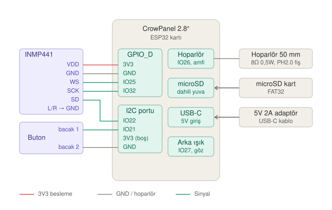

# HAL 9000 — Masaüstü sesli asistan

Elecrow CrowPanel 2.8" ESP32 ekran kartı üzerinde çalışan, butona basınca dinlemeye
başlayan ve kendine özgü bir sesle cevap veren masaüstü asistan. Ekran, bir lensin
arkasında parlayan göz olarak kullanılıyor.

## Nasıl çalışır?

1. Butona basılır, göz yavaşça "nefes almaya" başlar: HAL dinliyor.
2. Konuşma mikrofondan alınır, SD karta WAV olarak kaydedilir. Sessizlik algılanınca kayıt biter.
3. Kayıt n8n webhook'una gönderilir. n8n sesi yazıya çevirir, Claude cevabı üretir,
   ElevenLabs cevabı `wav_16000` formatında seslendirir.
4. Cevap SD karta indirilir ve hoparlörden çalınır. Göz, sesin şiddetine göre titreşir.
5. HAL tekrar dinlemeye döner. Butona yeniden basılınca göz söner, mod kapanır.

Ayrıntılar: [docs/mimari.md](docs/mimari.md)

## Klasörler

| Klasör | İçerik |
| --- | --- |
| `firmware/` | ESP32 yazılımı (Arduino IDE projesi) |
| `n8n/` | n8n akışı (ses → yazı → Claude → ElevenLabs → ses) |
| `enclosure/` | 3D baskı parçaları (OpenSCAD kaynakları ve STL çıktıları) |
| `docs/` | Donanım notları, pin tablosu, devre şeması, mimari |

## Parçalar

| Parça | Not |
| --- | --- |
| Elecrow CrowPanel 2.8" ESP32 | ESP32-WROOM-32, 320×240 ILI9341, microSD yuvası, hoparlör çıkışı |
| INMP441 I2S mikrofon | 3V3 ile beslenir |
| Buton | İki bacaklı, basıp bırakmalı |
| YD50 8Ω 0,5W hoparlör (50 mm) | PH2.0 2 pinli fiş lehimlenecek |
| microSD kart | 4–16 GB, FAT32 |
| 45–50 mm dışbükey lens | Gözün önüne |
| 5V 2A adaptör, USB-C kablo | |
| HY2.0-4P (Crowtail) kablolar | Mikrofon ve buton bağlantısı |

Pinler ve bağlantı notları: [docs/donanim.md](docs/donanim.md)

## Durum

- [x] Donanım seçimi ve devre şeması
- [ ] 1. aşama yazılım: göz efekti, buton, SD karttan ses çalma
- [ ] 2. aşama yazılım: mikrofondan kayıt, n8n bağlantısı
- [ ] n8n akışı
- [ ] ElevenLabs'te HAL sesi (Voice Design)
- [ ] 3D baskı iç parçalar: kart tutucu, lens yuvası, hoparlör ses odası, mikrofon ve buton yuvaları
