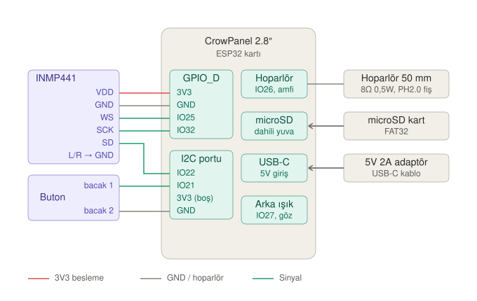

# Donanım notları

## Kart: Elecrow CrowPanel 2.8" ESP32 HMI

| Özellik | Değer |
| --- | --- |
| Modül | ESP32-WROOM-32-N4 (4 MB flash, 520 KB SRAM, PSRAM yok) |
| Ekran | 2.8" TFT, 240×320, ILI9341V (görüntü alanı yaklaşık 57×43 mm) |
| Dokunmatik | Rezistif, XPT2046 (ekranla aynı SPI hattında) |
| USB-seri çip | CH340C (Windows'ta CH340 sürücüsü gerekebilir) |
| Besleme | 5V, USB-C |
| Diğer | microSD yuvası, hoparlör çıkışı (IO26, dahili amfi), pil konnektörü |
| Genişleme | 4× HY2.0-4P (Crowtail) port, çıplak pin başlığı yok |

Kaynak: SAFEJETS FR projesindeki donanım notları (Elecrow wiki ve espboards.dev).

## Kartın kendi pinleri

| İşlev | GPIO |
| --- | --- |
| LCD SCLK / MOSI / MISO | 14 / 13 / 12 |
| LCD CS / DC / RST | 15 / 2 / yok |
| Arka ışık (göz parlaklığı) | 27 (PWM) |
| Dokunmatik CS | 33 |
| microSD SCK / MISO / MOSI / CS | 18 / 19 / 23 / 5 |
| Hoparlör (dahili amfi) | 26 |

## HAL için eklenen bağlantılar

| Parça | Pin | Kart | Port |
| --- | --- | --- | --- |
| INMP441 | VDD | 3V3 | GPIO_D |
| INMP441 | GND | GND | GPIO_D |
| INMP441 | WS | IO25 | GPIO_D |
| INMP441 | SCK | IO32 | GPIO_D |
| INMP441 | SD | IO22 | I2C |
| INMP441 | L/R | GND (sol kanal) | Modül üzerinde GND'ye |
| Buton | bacak 1 | IO21 | I2C |
| Buton | bacak 2 | GND | I2C |
| Hoparlör | iki uç | Hoparlör girişi (PH2.0) | Kartın kendi çıkışı |

Robot Sepeti'nin "Stereo Mikrofon Modülü I2S" ürünü de aynı şekilde bağlanır:
V = VDD, G = GND, LR = L/R, CK = SCK, DA = SD.

## Dikkat

- **Port pin sırası:** Şemadaki sıra okunabilirlik için seçildi. Bağlamadan önce kartın
  üzerindeki etiketlere ve kablo renklerine bak.
- **Mikrofon 3V3 ile beslenir.** 5V'a bağlanırsa modül zarar görebilir.
- **I2C portu** normal amacı dışında kullanılıyor (IO22 mikrofon verisi, IO21 buton).
  Bu projede I2C'ye ihtiyaç yok.
- **Buton** için direnç gerekmiyor, ESP32'nin dahili pull-up direnci kullanılıyor.
- **Hoparlör 0,5W.** Yazılımda en yüksek ses seviyesi %70 ile sınırlanacak.
  Hoparlörün +/− yönü önemli değil.
- **SD kart** FAT32 formatlanmalı, kökte `/hal` klasörü olmalı.

## Neden bu mikrofon?

ESP32'nin iki I2S birimi var. Hoparlöre giden dahili DAC çıkışı I2S0'ı kullanıyor.
INMP441 I2S1'e bağlanıyor, böylece ikisi birbirine karışmıyor. Analog mikrofonlar
(MAX9814 gibi) ve PDM mikrofonlar ESP32'de I2S0'a ihtiyaç duyduğu için bu kartta
hoparlörle çakışıyor.

## Göz

- Ekranın önünde yaklaşık 42 mm çaplı yuvarlak açıklık ve 45–50 mm dışbükey lens olacak.
- Göz görüntüsü ekrana bir kez çizilir. Nabız ve titreşim efektleri arka ışığın
  parlaklığı (IO27 PWM) değiştirilerek yapılır.

## Hoparlör ses odası

50 mm hoparlörün arkasına kapalı bir hazne konacak. Haznenin iç derinliği yaklaşık
15–20 mm olacak. Kasa tasarımında panel genişliği en az 65–70 mm olmalı.
